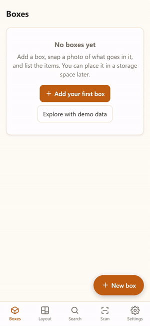
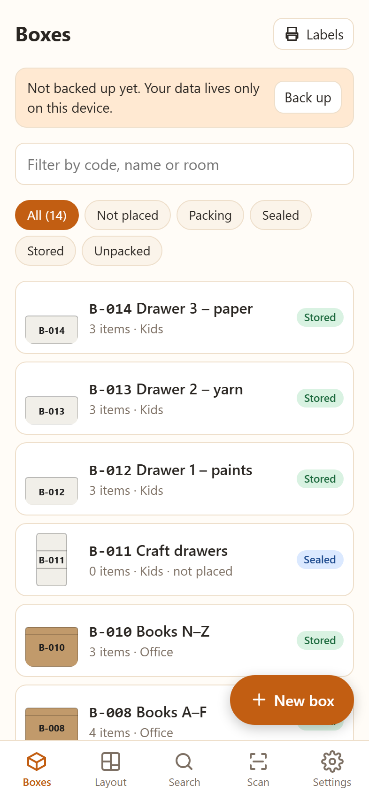
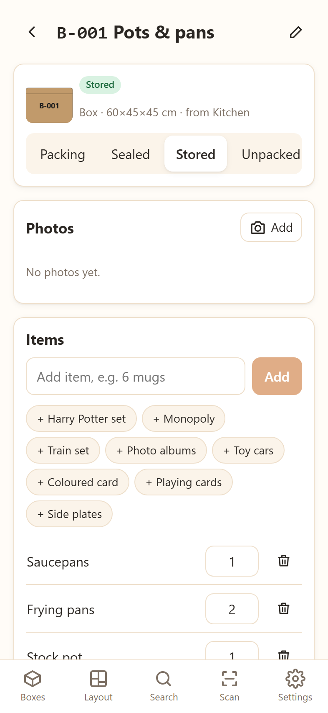
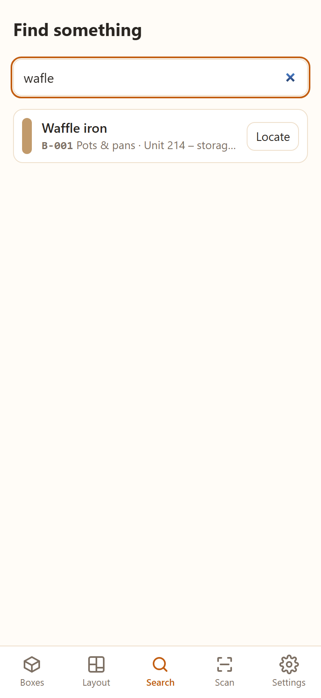
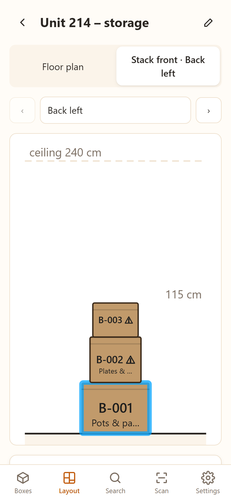
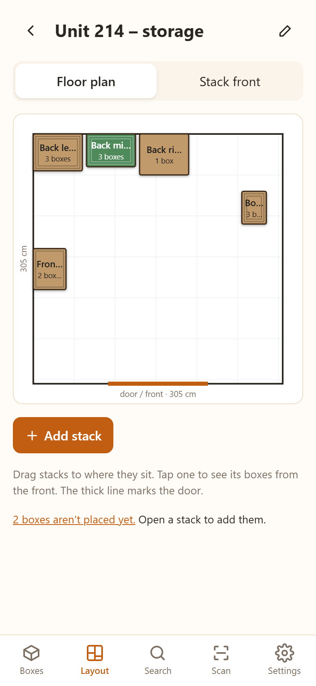
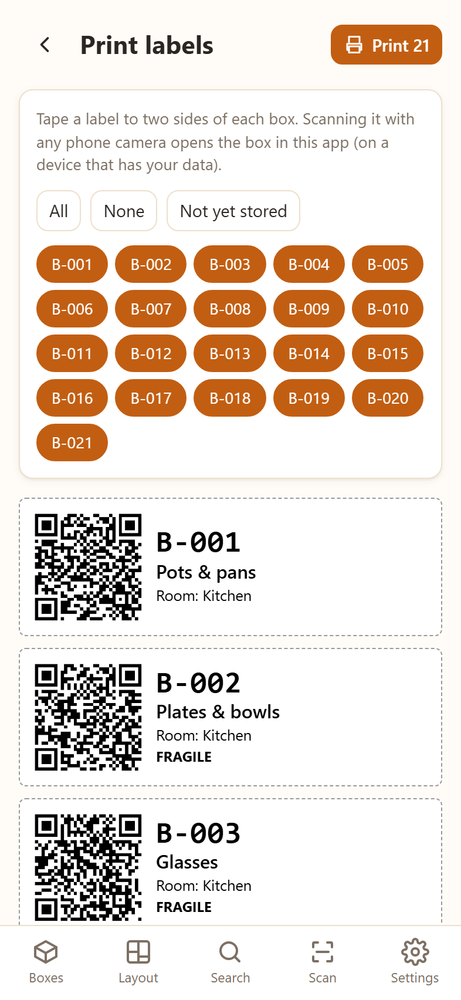

# StorageSolution

A free, offline-first phone app for packing a house into boxes and finding things again later.

**▶ Try it: [masonholland.github.io/StorageSolution](https://masonholland.github.io/StorageSolution/)**. Open it on your phone and tap **Explore with demo data** to load a sample household: two storage spaces, 21 boxes and drawers, and about 80 items. Search for "waffle" or "tent", then tap **Locate**. You can load or clear the demo at any time in **Settings → Demo data**.

<p align="center">
  
</p>
<p align="center"><sub><a href="docs/media/demo.mp4">Full-quality video (MP4)</a></sub></p>

## The problem

Packing up a home for a move or for long-term storage is a hassle, and it's hard to stay organised:

- **Contents are forgotten.** Once a box is taped shut, nobody remembers what's in it. "Kitchen" written in marker doesn't tell you which box has the waffle iron.
- **Locations are forgotten.** In a storage unit or garage with dozens of boxes stacked three high, finding one box means unstacking half the room.
- **Lists drift.** Paper lists and spreadsheets get lost, aren't with you at the storage unit, and don't match the boxes.
- **Existing tools cost money or need accounts.** Many inventory apps are subscriptions, cloud-only, or built for warehouses rather than households.

## The solution

StorageSolution logs every box as you pack it and records where it ends up:

| Feature | What it does |
|---|---|
| **Box log** | Each box, tote, bag or drawer unit gets a code (B-001, B-002…), a photo, the room it came from, its size, and flags such as *fragile* or *open first*. Its status moves from packing → sealed → stored → unpacked. |
| **Fast item entry** | Type items as you pack: `6 mugs` or `mugs x6` sets the quantity, and items you use often appear as one-tap buttons. Items can have tags. |
| **Photo → box colour** | The box colour is sampled from its photo, so the layout drawings look like the real boxes. |
| **Floor plan** | A to-scale top-down view of a storage space (unit, garage, spare room). Drag stacks of boxes to where they really sit. Overlapping stacks are outlined in red. |
| **Stack front view** | Each stack seen from the front, with boxes drawn to scale in their own colours, bottom to top, against the ceiling height. Reorder boxes, add unplaced boxes, or take boxes out. |
| **Search** | Search items, tags, rooms and box codes, with tolerance for typos. Results show the location, e.g. *Unit 214 › Stack 1 › 3rd from bottom*. **Locate** opens the layout with that box highlighted. |
| **QR labels** | Print a sheet of labels (QR code, box code, name, room, fragile flag). Scanning one with any phone camera, or with the in-app scanner, opens that box. |
| **Backup & sharing** | Export everything, photos included, as a `.zip`. Import it on another device by merging or replacing. |
| **Offline & installable** | It's a Progressive Web App (PWA): add it to your home screen and it works with no signal, which is common in storage units. |

**It costs nothing to run.** Everything is stored on your device, with no accounts, servers, paid APIs or tracking.

## Screenshots

<table>
  <tr>
    <td align="center"><br><sub>Boxes</sub></td>
    <td align="center"><br><sub>A box</sub></td>
    <td align="center"><br><sub>Search (with a typo)</sub></td>
  </tr>
  <tr>
    <td align="center"><br><sub>Locate: the box in its stack</sub></td>
    <td align="center"><br><sub>Floor plan</sub></td>
    <td align="center"><br><sub>QR labels</sub></td>
  </tr>
</table>

### Planned

- **Item suggestions from photos:** recognise items in a photo automatically. The hook for this is already built (`src/features/suggest/suggester.ts`). Options are an on-device model, Google Gemini's free tier, or a user's own Claude API key.
- **3D view:** box positions are already stored in real 3D units (cm), so a 3D view (e.g. react-three-fiber) can read the same layout data.
- **Optional cloud sync:** for example Supabase, added behind the existing data layer (`src/db/repo.ts`).

## Tech stack

All open-source and free.

| Area | Choice |
|---|---|
| Language | [TypeScript](https://www.typescriptlang.org/) |
| UI | [React 19](https://react.dev/) with [React Router 7](https://reactrouter.com/) (hash routing, so it works on any static host) |
| Build tool | [Vite 8](https://vite.dev/) |
| Offline / install | [vite-plugin-pwa](https://vite-pwa-org.netlify.app/) (service worker and web app manifest) |
| Local database | [Dexie.js 4](https://dexie.org/) over IndexedDB, with `dexie-react-hooks` for live-updating queries |
| Search | [MiniSearch](https://lucaong.github.io/minisearch/) (full-text search in the browser, with prefix and typo matching) |
| 2D layout views | Hand-written SVG; positions come from pure functions in `layoutMath.ts` |
| Photos | [browser-image-compression](https://github.com/Donaldcwl/browser-image-compression) (resizes to WebP and makes thumbnails) and a canvas-based dominant-colour picker |
| QR codes | [qrcode](https://github.com/soldair/node-qrcode) to generate, [qr-scanner](https://github.com/nimiq/qr-scanner) to scan |
| Backup | [JSZip](https://stuk.github.io/jszip/) |
| Unit tests | [Vitest](https://vitest.dev/) and [fake-indexeddb](https://github.com/dumbmatter/fakeIndexedDB) |
| End-to-end tests | [Playwright](https://playwright.dev/) on a phone-sized viewport |
| Lint | [oxlint](https://oxc.rs/) |
| README media | [Playwright](https://playwright.dev/) and [ffmpeg-static](https://github.com/eugeneware/ffmpeg-static) (`npm run media`) |

## Run it locally

### Prerequisites

- **[Node.js](https://nodejs.org/) 26 LTS** (includes npm). Check with `node -v`. The project's version is pinned in `.nvmrc`, so with [nvm](https://github.com/nvm-sh/nvm) or [fnm](https://github.com/Schniz/fnm) you can just run `nvm use` or `fnm use`. Node 22.12 or newer also works.
- **[Git](https://git-scm.com/)** to download the code.

### 1. Download

```bash
git clone https://github.com/MasonHolland/StorageSolution.git
cd StorageSolution
```

Without Git, download the ZIP from the [repository page](https://github.com/MasonHolland/StorageSolution) (**Code → Download ZIP**), unzip it, and open a terminal in that folder.

### 2. Install dependencies

```bash
npm install
```

### 3. Start the app

```bash
npm run dev
```

Open **http://localhost:5173** in your browser. Data you enter is saved in that browser's local storage.

To get a phone-sized view on a desktop browser, open the developer tools (F12) and turn on device mode.

### 4. (Optional) Try it on your phone

The camera and the QR scanner need HTTPS, so there's a separate command that serves the app over HTTPS on your local network:

```bash
npm run dev:phone
```

1. Connect your phone to the same Wi-Fi as your computer.
2. Open the **Network** address the command prints, e.g. `https://192.168.1.20:5173`.
3. Your phone will warn that the certificate isn't trusted, because it's a development certificate made on your computer. Choose to continue anyway.
4. To install it, use the browser menu → **Add to Home Screen**.

If the page doesn't load, allow Node.js through your computer's firewall for private networks.

### Other commands

| Command | What it does |
|---|---|
| `npm test` | Run the unit tests once |
| `npm run test:watch` | Run unit tests on every file change |
| `npm run e2e` | Build the app and run the end-to-end tests. The first time, run `npx playwright install chromium` to download the test browser. |
| `npm run build` | Production build into `dist/` |
| `npm run preview` | Serve the production build at http://localhost:4173 (offline mode works here) |
| `npm run lint` | Lint the code |
| `npm run media` | Re-record the screenshots and demo video in `docs/media/` (see below) |

## Deploy (free)

This repo deploys itself: every push to `main` runs the unit tests, builds the app and publishes it to GitHub Pages (`.github/workflows/deploy.yml`). To deploy a fork, go to **Settings → Pages** and set **Source** to **GitHub Actions**.

`npm run build` produces a static site in `dist/` that runs on any static host. Free options include [Cloudflare Pages](https://pages.cloudflare.com/), [GitHub Pages](https://pages.github.com/) and [Netlify](https://www.netlify.com/). Use build command `npm run build` and output folder `dist`. These hosts all provide HTTPS, which the camera and offline support need.

## Screenshots and demo video

`npm run media` records everything in `docs/media/` with Playwright in a phone-sized Chromium. It starts the dev server if it isn't already running, loads the demo data in a fresh browser profile (your own data isn't touched), and writes PNG screenshots, `demo.mp4`, `demo.gif` (used above) and `demo-poster.jpg`. Use `npm run media -- --only shots` or `--only video` to do half. The steps are in `scripts/media/capture.mjs`.

## Project structure

```
src/
  app/         App shell, routes, bottom navigation, shared UI and icons
  db/          Data model (schema.ts), Dexie database (db.ts), data access layer (repo.ts)
  features/
    containers/  Box list, detail page, create/edit form
    items/       Fast item entry
    capture/     Camera capture, photo processing, photo gallery
    spaces/      Storage spaces
    layout/      Floor plan, stack front view, layout geometry (layoutMath.ts)
    search/      Search index and page
    labels/      Printable QR labels and scanner
    backup/      Zip export/import and backup reminder
    settings/    Settings page
    suggest/     Interface for photo → item suggestions (not yet implemented)
  lib/         Box codes, image compression, dominant colour, storage persistence
e2e/           Playwright end-to-end tests
scripts/media/ Records the README screenshots and video
docs/media/    Screenshots and demo video used in this README
```

The data model is **Space → Stack → Container → Item / Photo**. All sizes are in centimetres. A box's height off the floor isn't stored: it's calculated from the boxes below it in the stack.

## Good to know

- **Your data lives only on the device and browser you used.** Download a backup from **Settings** regularly, and import it to move data to another device.
- **iPhone/iPad:** Safari may clear data for websites that aren't installed. Add the app to your Home Screen, turn on *persistent storage* in Settings, and keep backups.
- **QR labels** open the box only on a device that has your data. Anyone can still read the printed code and name.
